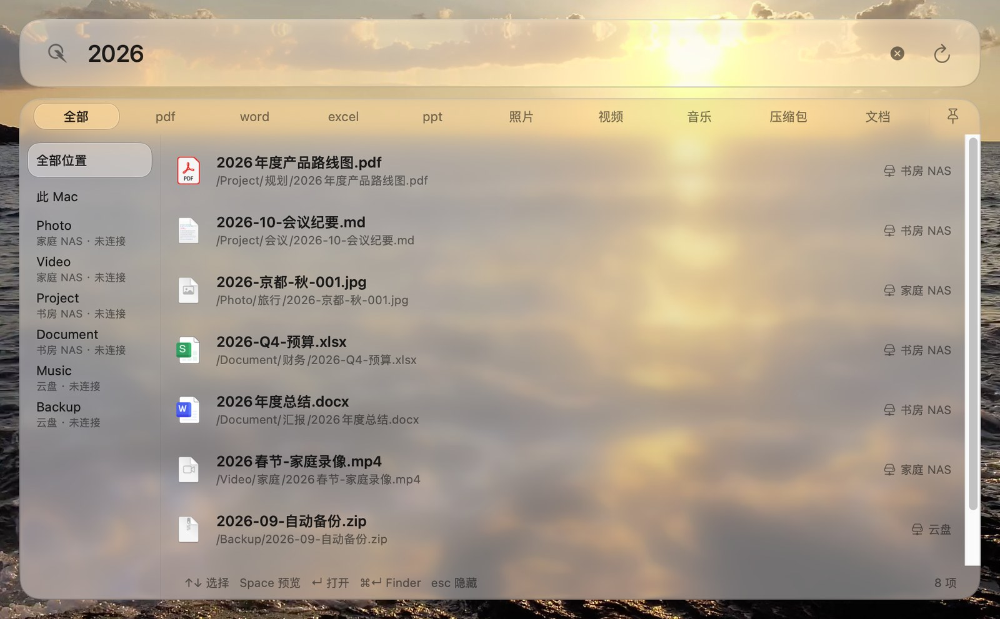

<div align="center">
  
  <h1>闪寻 FlashFind</h1>
  <p><b>按 ⌥Space，直接搜你 NAS 上的文件。</b><br>
  macOS 菜单栏小工具 · 不用先在访达里挂载共享文件夹</p>
  <p>
    <a href="https://github.com/qingxingLi/flashfind/releases/latest"></a>
    
    
    <a href="LICENSE"></a>
  </p>
</div>

闪寻把 NAS 自己的搜索能力，接到一个随时能呼出的搜索框上：搜索请求由客户端**直连你配置的设备**
（群晖 DSM、飞牛 fnOS、OpenList）发出，不经过任何中间服务器；结果点开的那一刻才按需挂载、
用系统方式打开。它不会为你的 NAS 在本地另建一份索引，也不把整个目录树拉回来慢慢翻
（唯一的例外是 WebDAV，它只能靠遍历，所以标着实验性）。

> [!NOTE]
> 分发包是 ad-hoc 签名、**未经 Apple 公证**，首次打开会被 Gatekeeper 拦一次。
> 放行方式见 [安装与首次打开](docs/安装与首次打开.md)，只需要做一次。



## 安装

到 [Releases](https://github.com/qingxingLi/flashfind/releases/latest) 下载对应芯片的包：

| 你的 Mac | 文件 |
| --- | --- |
| Apple Silicon（M1 / M2 / M3 / M4…） | `FlashFind-1.1.50-arm64.dmg` 或 `FlashFind-1.1.50-arm64.zip` |
| Intel | `FlashFind-1.1.50-x86_64.dmg` 或 `FlashFind-1.1.50-x86_64.zip` |

文件名的版本号以 Releases 页显示的最新版为准。芯片型号在「苹果菜单 ▸ 关于本机 ▸ 芯片」里看。没有做 universal 单包（体积会翻倍），两个包内容一样，
只是搜索核心按架构各编了一份。打开 dmg 或解压 zip 后，把「闪寻」拖到「应用程序」文件夹。

首次启动时：

1. Gatekeeper 拦下 → 右键点「闪寻」→「打开」，或按 [安装与首次打开](docs/安装与首次打开.md) 去掉隔离标记；
2. 授予**完全磁盘访问**（没有它，桌面、文稿等受保护目录里的文件搜不到）；
3. 在设置里添加来源：填 IP 或域名 → 登录 → 勾选允许搜索的根目录。

## 使用

按 **⌥Space** 呼出搜索框（快捷键可在设置里改），直接打字。

| 键 | 动作 |
| --- | --- |
| `⌥Space` | 呼出 / 收起搜索框 |
| `↓` `↑` | 在结果里移动 |
| `Space` | 预览；再按一次关闭预览 |
| `↩` | 用系统方式打开选中的文件 |

点窗口外面任意处收起。四件值得知道的事：

- **类型条**：结果区顶部是 全部 / pdf / word / excel / ppt / 照片 / 视频 / 音乐 / 压缩包 / 文档，
  过滤在客户端做，切换时结果区不会跳。
- **位置栏**：结果区左侧列出「全部位置 / 此 Mac / 每个来源下的每个搜索根」。选中某个根时，
  这个限定会**下推到设备侧**——只让设备扫那一个目录，而不是把结果拉回来再过滤，所以是真的更快。
  没连上的来源也在列表里（副标题写「· 未连接」），选中它先连上再搜。
- **一次 200 条**：结果区固定 7 行高，第一批先给 200 条，状态栏右侧的「继续搜索」再放一批，
  直到候选走完。200 不是上限。
- **图钉**：把当前这批结果留在桌面单独一窗，搜索框空出来接着搜下一组。钉住的窗口保留它当时的
  类型与位置筛选，可以就地重筛，也可以单独拖到别处。


## 支持的文件来源

| 类型 | 协议 | 说明 |
| --- | --- | --- |
| 群晖 Synology | DSM `SYNO.FileStation.Search` v2 | 走 DSM 的 Web API，支持 OTP 双因子登录 |
| 飞牛 fnOS | `appcgi.finder.fileSearch`（设备侧文件名索引） | 官方协议**没有**账号密码登录，走 OAuth 2.0 授权码：点「获取授权码」打开浏览器，登录后把页面上的一次性 code 贴回表单，闪寻里不存 NAS 账号密码 |
| OpenList | `/api/fs/search` | 自带账号体系，支持 2FA 动态码；按搜索根查询，最多 4 路并发 |
| WebDAV / 威联通 / 绿联 | 实验性，默认隐藏 | 需在设置里打开「显示实验性搜索来源」。WebDAV 走 `PROPFIND` 遍历目录，未经真机全面验证，速度与连通性不做承诺 |
| SMB / CIFS | 系统 `mount_smbfs` | 不作为搜索来源；只在打开结果时匹配本机已有的挂载 |

局域网发现走五路证据合并：Bonjour / Synology UDP 9999 / SSDP / ARP / TCP 端口探测
（端口探测已降级为兜底，只探「ARP 说在线但拿不到任何识别证据」的主机）。发现只覆盖本机所在的 `/24`。

## 它是怎么搜的

1. 你打字 → 客户端向每个已配置的来源发查询：群晖 `SYNO.FileStation.Search`、
   飞牛 `appcgi.finder.fileSearch`、OpenList `/api/fs/search`。
2. 设备返回自己的索引里匹配的文件名与元数据，客户端合并、去重，按
   `0.72 × 匹配度 + 0.28 × 新近度` 排序，再按**同名 > 前缀 > 命中字符多 > 可能相关**分层。
3. 你点开某一条时才做三件事：核对文件还在不在（设备索引是快照，可能已过期）、
   选一条能用的打开方式（本机已经挂载了这个共享就直接走挂载点，否则按需挂载或用设备的下载链）。

所以搜索不需要任何挂载，**挂载只发生在打开的那一刻**。群晖、飞牛、OpenList 三条线是同一套判据：
来源里填的是域名、而访达里用局域网 IP 挂着同一个共享，也能认出来并直接用访达打开。

## 和聚焦搜索、Everything 是什么关系

三者不是一类工具，放在一起说清楚定位：

| | 闪寻（macOS） | macOS 聚焦（⌘Space） | Everything（Windows） |
| --- | --- | --- | --- |
| 平台 | macOS 13+ | macOS | **仅 Windows，没有 macOS 版** |
| 搜 NAS 上的文件 | 直连群晖 / 飞牛 / OpenList，不用先挂载 | 网络挂载卷基本不在它的索引范围里 | 不支持；只能搜挂载成本地盘符后的路径 |
| 一次搜索合并多台设备 | ✓ 结果按匹配度合并、去重 | — | — |
| 本机文件 | ✓ 走系统索引，或指定文件夹 | ✓ | ✓（NTFS 主文件表，极快） |
| 搜文件内容 | ✗ 只搜文件名 | ✓ | ✓（开内容选项后较慢） |
| 索引在哪 | 不建新索引，直接查设备自己的文件名索引 | 本机索引，网络卷基本不在内 | 本机 NTFS 主文件表 |
| 首次使用要建索引吗 | **不用**，添加来源即可搜 | 系统自动维护 | 首次全盘扫描（之后靠 NTFS 日志增量维护） |
| 位置限定 | ✓ 下推到设备侧，只扫那一个目录 | ✗ | 按盘符 / 路径过滤 |
| 结果钉住成独立小窗 | ✓ | ✗ | ✗ |
| 接给 AI 客户端（MCP） | ✓ 默认关闭 | ✗ | ✗（有 ES 命令行，可自己拼） |
| 许可 | Apache-2.0 | 系统自带 | 免费但闭源 |

一句话：Everything 证明了「文件名秒搜」在 Windows 上有多好用，聚焦能搜内容却基本搜不到 NAS。
闪寻做的是把前者那种「打文件名就出结果」的体验补到 macOS 上，并且一次就能问到你的几台 NAS。

**检索速度对比**。速度取决于三件事：查询在哪儿算、索引在哪儿、网络上搬多少数据——

- **搜本机**：聚焦（系统索引）和 Everything（NTFS 主文件表）都很快，这是它们的主场；
  闪寻搜本机走同一套系统索引，不另建、不更慢。
- **搜 NAS**：这是闪寻与另外两家真正拉开的地方。手动翻访达是「列一层、看一层」，每进一个
  目录都是一次局域网往返；闪寻把查询**下推到设备自己的文件名索引上算**，网络上只传回命中
  的文件名（第一批 200 条，边搜边出）。所以快慢主要取决于设备本身，跟共享文件夹里有多少
  文件基本无关——索引是 NAS 建好现成的，闪寻不建、也不搬。
- **代价也说清楚**：能搜多快取决于设备给不给索引。群晖走 DSM 的搜索接口、飞牛走系统文件
  索引、OpenList 走它自己的 `/api/fs/search` 索引接口，三者都是现成索引，闪寻不建、也不搬。
  个别没开索引功能的 OpenList 站点会搜不到结果——闪寻**不会**现场爬目录来凑，宁可空着。

## 接给 AI 客户端（MCP）

给支持 MCP 的客户端（Claude、Cursor、WorkBuddy 等）接上闪寻的检索能力，
让 AI 直接问「你那边有没有这个文件」，而不是猜路径。**默认关闭，不开就没有任何对外接口。**

在「设置 ▸ AI」里打开总开关、勾选允许它搜哪几个来源，再复制下面那段「接入提示词」粘给 AI 客户端即可。

| 项 | 说明 |
| --- | --- |
| 助手 | `闪寻.app/Contents/Helpers/flashfind-mcp`，随应用分发，不用单独下载 |
| 通道 | 本机 unix socket（`~/Library/Application Support/FlashFind2/ipc/mcp.sock`，权限 `0600`，仅同一登录会话可连），不出网 |
| 工具 | `list_sources` / `search` / `locate` / `locate_many` / `get_metadata` / `recent` |

交出去的只有文件本身的信息：名称、所在来源、**相对路径**、大小、修改时间、类型，**不含文件内容**。
路径是去掉开头 `/` 与卷挂载点的形态（如 `Users/you/Documents/报告.pdf`）——如果你把「此 Mac」
也授权给它，这个相对路径基本就等于完整路径，请按「它能看到文件名和所在文件夹」来评估。
AI 引用文件时用的是不透明的 `file_id`；取消勾选某个来源后，连它的旧 `file_id` 也问不到东西。
随时可以收回：关掉总开关，或在同一页「清空 AI 历史」。

## 常见问题

**要先在访达里挂载 NAS 吗？**
不用。搜索直连设备，挂载只发生在你点开某个结果的时候。

**打开时提示「无法验证开发者」／「已损坏」？**
包没有做 Developer ID 签名与公证，这是预期行为。按 [安装与首次打开](docs/安装与首次打开.md) 放行一次即可。

**为什么每装一个新版本都会弹一次钥匙串授权？**
ad-hoc 签名下，系统按 cdhash 认应用身份，换版本就等于换身份。所有设备的密码在 1.1.5 起合并存成
**一条**记录，所以有 5 台 NAS 也只弹 1 次，同一版本内重启或覆盖安装不再弹。弹框请点**「始终允许」**
——点「允许」只对本次运行有效。签上 Developer ID 后这个问题才会消失。

**升级后桌面、文稿里的新文件搜不到了？**
「完全磁盘访问」的开关可能还显示为开、实际已失效（同样是换版本即换身份）。把开关**关掉再打开**，
然后**完全退出闪寻再启动**。

**某个文件明明在，就是搜不到？**
先分清是哪种：NAS 上的搜索走设备自己的索引，刚创建的文件要等设备侧更新；设备认为你没权限的目录
本来就不会返回。此 Mac 上的文件则依赖完全磁盘访问与系统索引。另外，群晖与飞牛返回的是索引快照，
文件已经被移走的条目会在你点开时提示找不到。

**会不会把我的文件信息传出去？**
不会主动传。没有账号、没有服务器、没有云端同步，对外只连你自己配置的 NAS 和检查更新。
唯一的例外是你自己开启的 MCP —— 那是把文件名与元数据交给**你选的**那个 AI 客户端，交多少由你勾选的来源决定，见上面那节。

## 已知限制

- **双架构分开发包**：Apple Silicon 用 `arm64`，Intel 用 `x86_64`；`LSMinimumSystemVersion = 13.0`。
- **未做 Developer ID 签名与公证**：Gatekeeper 会拦截，首次放行见 [安装与首次打开](docs/安装与首次打开.md)。
- **凭据停在经典钥匙串**：本包是 ad-hoc 签名、没有 `keychain-access-groups` entitlement，
  所以实际只到经典钥匙串那一档；签上 Developer ID 后，新写入的密码才会走 Data Protection，
  已有的由 `KeychainTierMigration` 搬一次。详见 [SECURITY.md](SECURITY.md)。
- **旧的明文凭据文件会自行消失**：1.0 时期落在
  `~/Library/Application Support/FlashFind2/credentials.json`（目录 0700、文件 0600）。
  1.0.1 起它只剩「迁移来源」一个用途——启动时搬进钥匙串，等某次真实登录验证通过后才逐条删除。
  迁移没走完时它会一直在，那是正常的。
- **局域网发现只扫本机所在的 `/24`**；`localIPv4()` 取第一个私有网卡，若该网卡没有掩码
  （某些 VPN 隧道）则整轮发现不执行。
- **飞牛的网页入口只能到站点首页**：飞牛的文件页是 SPA，官方不支持按路径定位，所以「在浏览器打开」
  落到站点根目录。

## 从源码构建

`build.sh` 只做分发，底下各是独立脚本。三个编译/打包子命令（`test` 见下）：

```bash
# 1) Dart 搜索核心（需要 Dart SDK 3.10.x 或更高；本项目用 3.13.5 验证）
#    位置自动发现：DART_SDK 环境变量 → PATH → 常见安装位
bash scripts/build.sh core

# 2) Swift 可执行体（要求 Resources/MyNAS 已就位，否则直接失败并指路，
#    绝不产出一个缺搜索核心的 App）
bash scripts/build.sh app

# 3) 打包（ad-hoc 签名，未做 Developer ID 公证）
bash scripts/build.sh package --release \
    --icon Resources/Brand/ShanXun.icns \
    --scratch <项目内的编译暂存目录> \
    --temporary-alias <指向该目录的短软链> \
    --output <项目内尚不存在的新目录>
```

两个路径要先自己建好（软链那一道是为了绕开 Swift 编译产物对路径长度的敏感）：

```bash
mkdir -p .ff2-scratch && ln -s .ff2-scratch .ff2-alias
```

> `--scratch` / `--temporary-alias` / `--output` 都必须在项目内，脚本会用 `relative_to(project)`
> 逐个校验，写 `/tmp/...` 会直接报「不在项目内」。不是洁癖：`build-record.json` 记录的是相对项目根的
> 路径与 SHA-256，路径出了项目就无从复现。

完整参数与「构建机路径不许进包」那几条硬闸见 [构建与打包](docs/构建与打包.md)。

### 跑测试

```bash
bash scripts/build.sh test       # Swift 全量 + MyNASCore 的行为套件
```

或分开跑：

```bash
swift test                        # 1796 项（4 条在预编译核心下跳过）
cd MyNASCore && dart test_*.dart  # 12 个套件（两个 live 套件要真机或真账号，脚本里跳过）
```

> `MyNASCore/test_webdav_live.dart` 默认在**本机**起一个真 WebDAV 服务器做端到端验证，不连外部设备；
> 只有显式传 `--base-url/--user/--password` 才会去连真机。

## 架构一瞥

```
FlashFind2App   界面层（SwiftUI + AppKit）—— 不可测，靠结构测试与人工点验
FlashFindCore   可测逻辑层（连接管理、设备归并、分类、结果排序）
MyNASCore       Dart 搜索核心，以子进程方式运行，stdin/stdout 走 JSON 行协议
```

**跨进程协议版本必须对齐**：Swift 侧 `MyNASProcessBridge.expectedCoreRevision` 与 Dart 侧
`protocol.dart` 的 `coreRevision` 必须一致，否则启动即报错退出。凭据只在需要时经 stdin 管道送进核心，
不落命令行、不写环境变量。

## 隐私

不收集、不上传任何数据：没有账号、没有服务器、没有云端同步，也就没有一个能接收的地方。
对外网络请求只有两类——连**你自己配置的** NAS，以及你点「检查更新」时向 GitHub 读一次公开的发布信息
（匿名、无参数、不点不发）。文件名只进本机索引（不含内容），密码存系统钥匙串。

上面那节的 AI 访问走的是**本机 socket**，不是第三类网络请求；它默认关闭，且只在你勾选的范围里、
只回文件名与元数据。**AI 客户端本身是不是联网、会不会把拿到的东西发出去，取决于那个客户端，
不取决于闪寻**——它是你的另一个软件，闪寻没有能力也无意替它承诺。

全文、本机落点清单与四步自查命令见 [PRIVACY.md](PRIVACY.md)。

## 参与开发

请先读 [CONTRIBUTING.md](CONTRIBUTING.md)。本项目的测试纪律比较硬（App 层不可实例化，界面层靠扫源码
做结构测试；改动必须先在未修源码上跑红），不读容易返工。

- 安全问题请按 [SECURITY.md](SECURITY.md) 私下报告，不要开公开 issue。
- 名称与图标按 [TRADEMARK.md](TRADEMARK.md) 保留；第三方组件见 [NOTICE](NOTICE)。
- 许可：[Apache-2.0](LICENSE)。

## 版本

源码与安装包同步到 **1.1.50**。逐版细节（改动文件、门禁条数、为什么这么改）见
[架构](docs/架构.md) 的版本表，上游与素材来源见 [UPSTREAM](docs/UPSTREAM.md)。

| 版本 | 要点 |
| --- | --- |
| 1.1.50 | 只改打包：安装包里的二进制不再带构建机的绝对路径，用户可见变化为零 |
| 1.1.31–1.1.49 | **飞牛转正**（走设备侧文件名索引，登录改 OAuth 授权码）；群晖 / 飞牛 / OpenList 三线统一认「本机已挂载」；四层排序；三家各自的**黑白品牌标记**；搜索框描边在浅色下加深、占位改成品名「闪寻」 |
| 1.1.22–1.1.30 | 结果区**类型条**、左侧**位置栏**、**模糊搜索**、一次 200 条 +「继续搜索」、**图钉钉住**、搜索框与结果窗各自独立拖动、结果区固定 7 行；1.1.30 剔除已废弃产品线代码 |
| 1.1.20–1.1.21 | 位置全选 / 取消全选、来源改名即生效、整根（`/`）当搜索位置、结果多时不再卡顿；界面改 Liquid Glass |
| 更早 | 见 [架构](docs/架构.md) 的版本表 |
